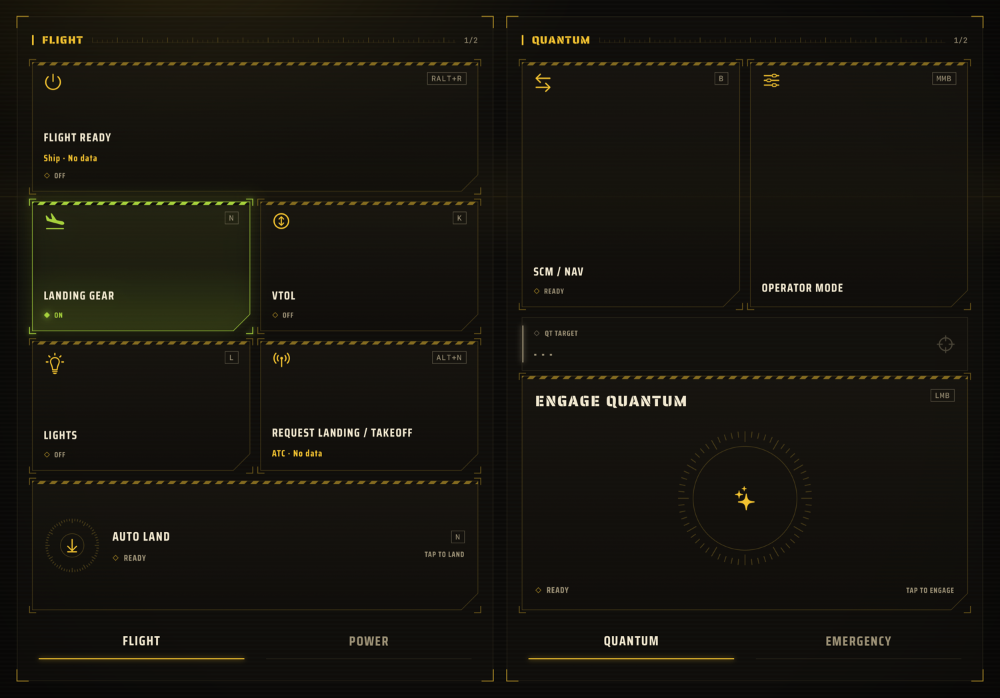
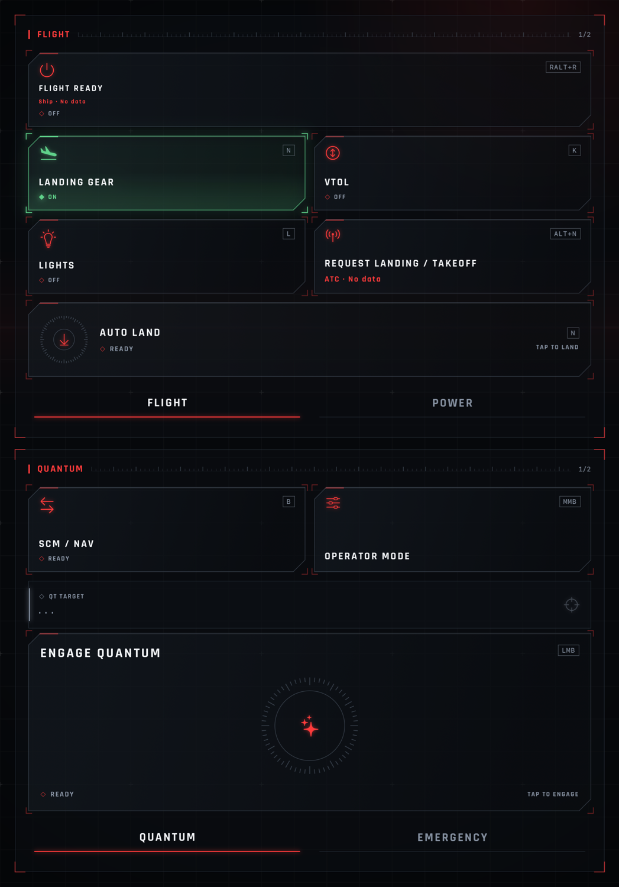
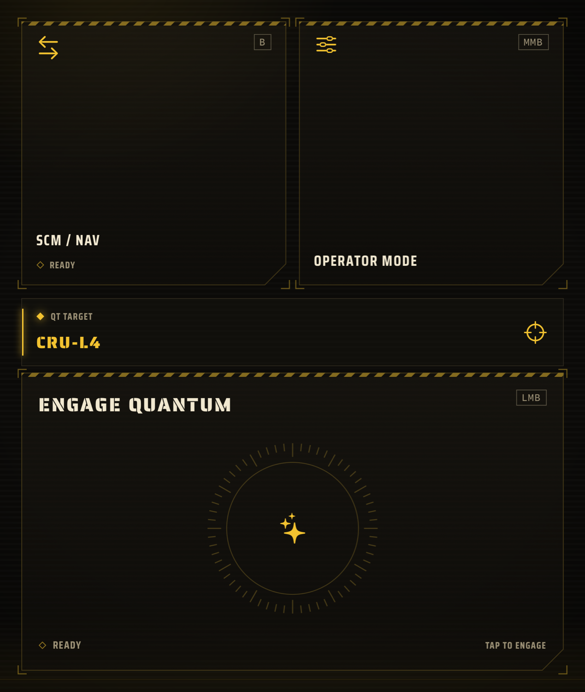
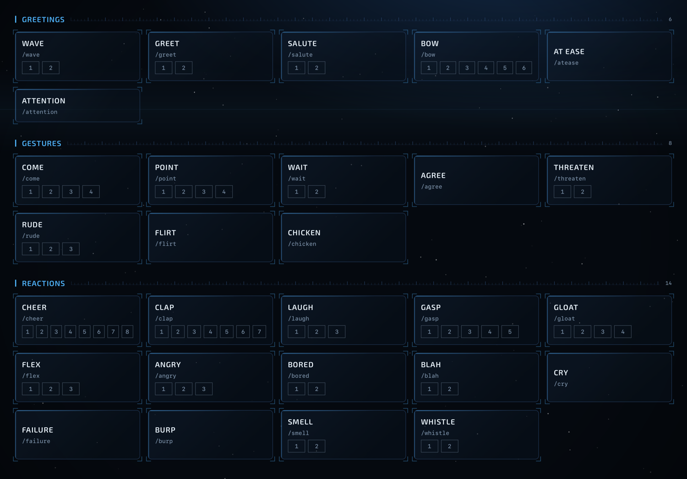
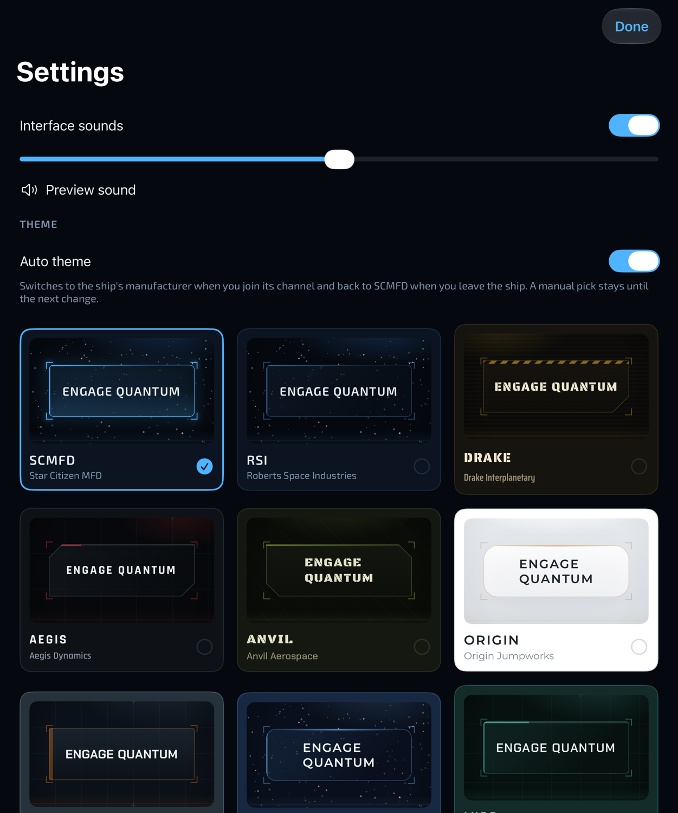
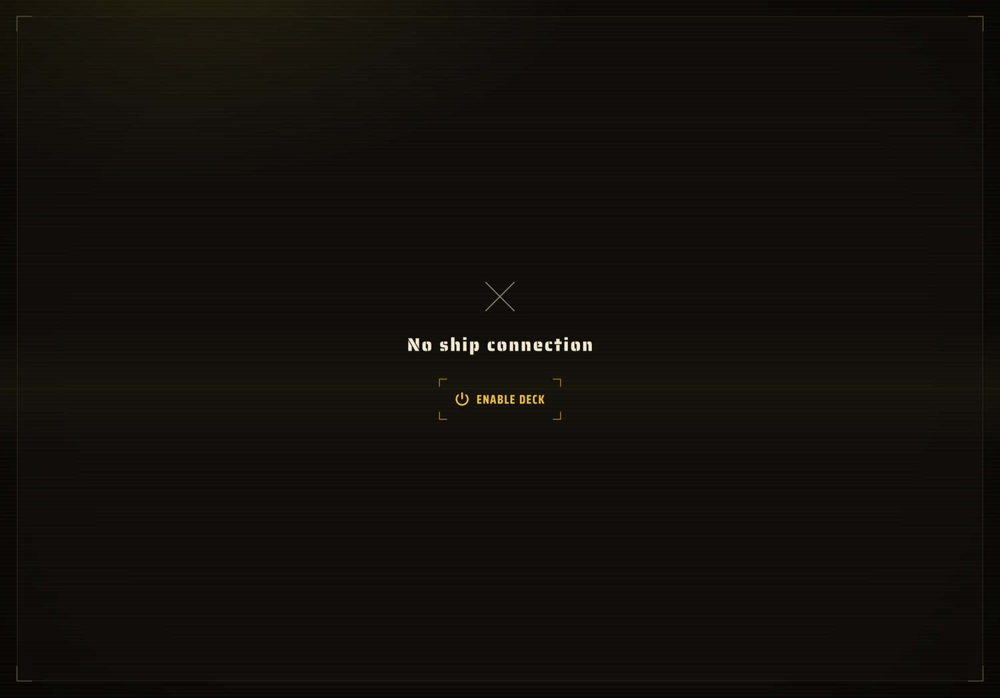

# SCMFD — iPad MFD for Star Citizen

SCMFD turns an iPad into a multi-function display for Star Citizen. Ship functions (flight ready, landing gear,
lights, power, quantum, ATC landing request…) and emotes sit on themed touch keys; a small companion server on the
gaming PC presses the matching game bindings and reports what it reads from `Game.log`.

This repository is the **iPad app (SwiftUI)**. Its companion is the
[SCMFDBE Windows server](https://github.com/Dima-McArrow/SCMFDBE) (.NET 10).
Both sides follow **protocol v2**, specified in section 41 of
[`Claude outputs/CSMFD-discussion.md`](Claude%20outputs/CSMFD-discussion.md).

## Two repositories, one companion

| Repository | Role | Runs on |
|---|---|---|
| [SCMFD](https://github.com/Dima-McArrow/SCMFD) (this repository) | Touch controls, themes, observed activity and local history | iPad |
| [SCMFDBE](https://github.com/Dima-McArrow/SCMFDBE) | Game input, log observations, pairing and secure transport | Windows gaming PC |

For connected use, build both projects and put the iPad and PC on the same private network. Follow the
[server setup and pairing instructions](https://github.com/Dima-McArrow/SCMFDBE#first-start), then use
**Connect to PC** in the iPad app. Update both sides together when the shared protocol changes.

```text
 iPad (this app)                         Windows PC
 ┌─────────────────────┐   wss:// TLS    ┌──────────────────────────┐
 │ Deck · Emotes · Info│ ──────────────▶ │ CSMFD.Server (tray app)  │──SendInput──▶ Star Citizen
 │ ServerConnection    │ ◀────────────── │ Game.log tailer + state  │◀─Game.log──┘
 └─────────────────────┘ ack · state     └──────────────────────────┘
```

## Why SCMFD?

**Touch controls and log-driven information, together on a native iPad MFD.** SCMFD combines a cockpit-style
control surface with feedback from the events Star Citizen exposes in `Game.log`. The aim is to make useful
log observations visible beside the controls you use, and expand that feedback as more event formats are verified.

- **A cockpit that follows your ship.** With Auto theme enabled, a recognized ship-channel join switches the
  interface to the ship manufacturer's theme. Leaving the ship channel returns it to the default SCMFD theme.
  The 18 manufacturer themes bring their own palettes, fonts, key shapes and HUD details; manual selection
  remains available.
- **Your selected quantum destination beside Engage.** When a starmap selection is reported in the log, the
  Quantum page shows its target name directly above the Engage key. Target names can still be technical names;
  the app displays what the server actually observes.
- **Feedback beyond button presses.** Landing requests show pending, answered or timeout status. Observed
  contracts, objectives and rewards populate the session pages, while the read-only Party tab shows observed
  members, the last known leader and membership events, with explicit uncertainty when information is incomplete.
- **Native touch interaction.** SwiftUI controls, timed holds, a slide-to-arm for self-destruct, interface sounds
  and English/French/Russian text make the iPad a dedicated companion display.
- **A direct local connection.** The iPad talks to its Windows companion over the private network. Normal
  operation requires no project account, cloud service, AI provider or subscription. The PC reuses one log reader;
  presentation and history belong to the iPad.

Input is restricted to an allowlist, checked against game focus and physical-key conflicts, with release paths
for disconnects and other safety events. Log-derived information is partial; current validation and remaining
limits are documented below. No game-memory access or modification is used.

### Respect to fellow companion projects

Much respect to [GameGlass](https://gameglass.gg/) for its touchscreen game-control panels and to
[Wingman AI](https://www.wingman-ai.com/) for showing how Star Citizen's game log can inform a companion's
responses to game events. SCMFD brings these two ideas together in its own form: a native iPad touch interface
and visual feedback driven by verified `Game.log` observations. It has no voice assistant; the shared idea with
Wingman AI here is reading the game log. Thanks to both teams and their communities for advancing companion
experiences in the 'verse.

## Features

- **Deck**: four pages of MFD keys (Flight, Power, Quantum, Emergency). Taps, toggles with a lit state, and
  one-tap timed holds (e.g. quantum engage 1.5 s, self-destruct 3 s behind a slide-to-arm). Quantum target readout
  and a landing-request indicator.
- **Emotes**: 48 emote families / 132 chat commands (`/wave`, `/dance3`…), listed in
  `SCMFD/Commands/Emote.swift`.
- **Session Contracts and Finances**: live observed contract/objective events and reward totals, with reconnect
  deduplication and saved iPad history. Spending, fines and wallet balance are not tracked. See
  [`SESSION-REWARDS-CONTRACTS.md`](SESSION-REWARDS-CONTRACTS.md) and protocol section 41.21.
- **18 manufacturer themes** (RSI, Drake, Aegis, Anvil, Origin, MISC, Crusader, …) with their own palettes, fonts,
  key shapes and HUD details, plus interface sounds. The default **SCMFD** theme is the RSI look under the app's
  own name, for when no ship is involved ([`DEFAULT-THEME-DESIGN.md`](DEFAULT-THEME-DESIGN.md)).
- **Localization**: English source strings with French and Russian translations (`Localizable.xcstrings`).
- **Connect to PC**: tap the link status in the top bar, scan the QR code from the server's Pair window with the
  iPad camera, type the 6-digit code. Manual address entry with a fingerprint check is the fallback.
- **Debug tab** (Debug builds only): LAN reachability check and live feedback from the server connection.

## Screenshots

Captured from the app's SwiftUI previews with sample interface states. These illustrate the layouts and themes;
the quantum destination is preview data, not a live game observation. Click an image to view it at full size.

| Deck · landscape | Deck · portrait |
|:---:|:---:|
| [](screenshots/deck-landscape.png) | [](screenshots/deck-portrait.png) |

| Quantum controls | Emotes |
|:---:|:---:|
| [](screenshots/quantum-controls.png) | [](screenshots/emotes.png) |

| Theme picker | Deck off · manual enable |
|:---:|:---:|
| [](screenshots/theme-picker.png) | [](screenshots/no-ship-connection.png) |

## Security model

The PC accepts input only from one paired iPad. In short:

- `wss://` only, never a plain `ws://` fallback.
- **Certificate pinning**: the iPad trusts exactly one certificate, identified by the SHA-256 fingerprint shown on the
  PC (QR code `csmfd://pair?v=2&host=…&port=47823&id=…&fp=…`, or compared by eye in manual pairing).
  Nothing is sent before the TLS check passes.
- **Pairing**: a one-time 6-digit code from the PC's Pair window, then a token stored in the iPad Keychain
  (`WhenUnlockedThisDeviceOnly`, never synced to iCloud).
- Commands carry UUIDs and get exactly one ack. After a lost connection a pending command is reported as
  *unknown*, never retried automatically.

## License

**Source-available. Free for noncommercial use.**

Original project code is licensed under [PolyForm Noncommercial 1.0.0](LICENSE).
You may use, study, modify and share it for the purposes permitted by that license,
while retaining its terms and the [copyright notice](NOTICE). Copyright remains
with the respective rights holders.

[Additional permission](ADDITIONAL-PERMISSIONS.md) allows using and showing SCMFD
in monetized gameplay streams, videos, tutorials and reviews. Commercial sale of
the app or forks, incorporation into commercial products, and paid services based
on the software require separate written permission unless already permitted by
the license. This is a noncommercial source-available project, rather than an
OSI-defined open-source release.

Third-party components, bundled fonts and game materials retain their own licenses
and rights; the project license does not replace those terms. For commercial
licensing requests, contact [Dima-McArrow](https://github.com/Dima-McArrow).

## Requirements

- Xcode 27.1 (iOS 27.1 SDK); deployment target iOS/iPadOS 26.0.
- For a real connection: the [Windows server](https://github.com/Dima-McArrow/SCMFDBE) running on the same private
  network (see its [README](https://github.com/Dima-McArrow/SCMFDBE#readme) for firewall and pairing steps).

## Build and test

Open `SCMFD.xcodeproj`, scheme **SCMFD**.

The project, app and Swift module are named `SCMFD`. The app bundle identifier is `Dima-McArrow.SCMFD`;
the test bundle identifier is `Dima-McArrow.SCMFDTests`. This is a separate installation from the former
`Dima-McArrow.CSMFD` app; its local data is not migrated automatically.
The Keychain service, session-history path and protocol v2 identifiers (`csmfd://`, `/csmfd`, `CSMFD-iPad`)
retain their original spelling. Protocol identifiers must match the Windows server.

- **Run**: ⌘R on an iPad or the iPad simulator.
- **Test**: ⌘U. Tests use Swift Testing and run fastest on a simulator (e.g. *iPad Pro 13-inch (M5)*).

Command line:

```sh
xcodebuild -project SCMFD.xcodeproj -scheme SCMFD \
  -destination 'platform=iOS Simulator,name=iPad Pro 13-inch (M5)' test
```

## Project layout

| Folder | Content |
|---|---|
| `SCMFD/Commands` | `ShipAction` (functions + default bindings), `KeyChord`, `Emote`, `CommandLink` transport protocol |
| `SCMFD/Controls` | MFD keys, timed hold, slide-to-arm, tick ring |
| `SCMFD/Deck` | Deck screen, `DeckState`, disconnected state, quantum readout |
| `SCMFD/Emotes` | Emote board |
| `SCMFD/Network` | Protocol v2 DTOs, pairing link parser, Keychain store, TLS pinning, session state machine, WebSocket driver |
| `SCMFD/Pairing` | Connect to PC sheet (tap the link status in the top bar) and the AVFoundation QR scanner |
| `SCMFD/Theme` | SCMFD and manufacturer themes (`AppTheme` is the stored choice), fonts, key shapes, HUD primitives |
| `SCMFD/Settings` | Settings sheet: sounds, Auto theme, theme picker (Reset Deck is the top-bar icon) |
| `SCMFD/Debug` | Connection test screens (Debug builds) |
| `SCMFD/Sounds`, `SCMFD/Fonts` | Interface sounds; bundled OFL fonts (licenses in `Fonts/Licenses`) |
| `SCMFDTests` | Swift Testing suites: network layer, ship-context tracker, Deck state, themes, session history |
| `tools` | `gen-emotes-md.py`: emote list and server `emotes.txt` from `Emote.swift` |

## Status

| Part | State |
|---|---|
| Observed Party tab (41.24) | Implemented in source: iPad-owned partial member list, last known leader, bounded transient history and stale/gap labels. Requires updated BE; Mac build/Swift tests and game validation pending |
| UI: Deck, Emotes, themes, sounds | Working; the Deck starts off, and without a pairing Enable Deck turns it on and the keys go to `ConsoleCommandLink` (Xcode console) |
| Localization en/fr/ru ([FIX-06](FIX-06-missing-translations.md)) | Every catalog string has fr and ru; `Pair window` / `Pair iPad…` stay in English to match the PC app |
| Protocol v2, pairing link, Keychain, TLS pinning, session logic | Implemented and unit-tested; an unknown value in a server enum decodes to a safe fallback instead of ending the link, and every SCMFDBE protocol fixture is pinned in `ProtocolV2Tests` (156 tests, 251 runs on the simulator, 2026-10-28) |
| Connect to PC (in-app QR scanner, 6-digit code, manual fallback), WebSocket driver, auto-reconnect | Tested against the real server by the owner; no issues detected in the tested scenarios |
| Keys and emotes over the network: rejection feedback with a label for every cancel/reject reason, hold stops on `input_cancelled` | Tested in game by the owner; no issues detected in the tested scenarios |
| Live session rewards/contracts and saved history | Implemented in source; requires updated BE. Simulator build, Swift tests and in-game validation pending on Mac |
| One path for the Deck, the theme and the keys: `state.shipContext` only ([FIX-07](FIX-07-one-path-deck-and-theme.md), spec 41.23; replaces the channel-activity theme of FIX-04 and the ClearDriver rules of FIX-02). Deck off at app start, on after `channelJoined`, off after a leave / `vehicleDestroyed` / game end / log reset; Auto theme follows the same transitions; keys reset only on `vehicleDestroyed` or Reset Deck; one-tap Enable Deck on the off screen | Implemented and unit-tested on the simulator (2026-10-28); not yet verified against the real server or in game |
| QT readout and ATC status mirrored from state ([FIX-03](FIX-03-quantum-target-and-atc-from-state.md)) | Implemented and unit-tested; not yet verified against the real server |
| Readable names for quantum targets ([FIX-08](FIX-08-quantum-target-names.md)) | Planned, not implemented: the readout still shows the raw `internalName` |
| QT target readout directly above the Engage quantum key ([FIX-09](FIX-09-qt-readout-above-engage.md)) | Implemented (layout only, 2026-10-28), checked in previews; not yet checked on the device |

## Keeping the emote list in sync

The server only types emotes listed in its `emotes.txt`. After changing `Emote.swift`, regenerate the list:

```sh
python3 tools/gen-emotes-md.py SCMFD-emotes.md
```

and copy its `emotes.txt` block to `%LocalAppData%\CSMFD\emotes.txt` on the PC.

## Session reliability follow-up (2026-10-28)

See [SESSION-RELIABILITY-FIXES.md](SESSION-RELIABILITY-FIXES.md) for the observed failures, source fixes,
verification results and the remaining Mac/game checks.

## Observed Party MVP (2026-10-28)

The Party tab is independent of Deck/seat/theme and makes no game commands. Names are exact observed
display names, not online status or a complete roster. Party history is transient (128 events / 64 names);
finance session resets do not reset it. No old financial history is treated as current membership.

No authoritative roster, local PU leave/kick, alias mapping or shard continuity is established.
Invites, marker stream-out and launch acceptances do not update membership. Update both sides together;
older activity clients may label new kinds as incomplete finance history. The running server is not replaced
automatically. See protocol section 41.24 in the iPad repository for the wire contract and test scenario.

Party validation on Windows: Release build passed with zero warnings; all 399 BE tests passed,
including mixed Party/reward WSS paging, reconnect replay and denial to unpaired clients. Formatting check
passed. A read-only replay of 37 real logs (2,621,104 lines) produced 43 Party facts, matching the independent
source scan: 1 creation, 6 local joins, 7 member joins, 16 member leaves, 10 leader changes and 3 disbands.
Swift tests are added but cannot run on this Windows machine. Before in-game testing, build/test the iPad
app on Mac and use the matching updated BE build. Check the Party tab in portrait/landscape and en/fr/ru.
